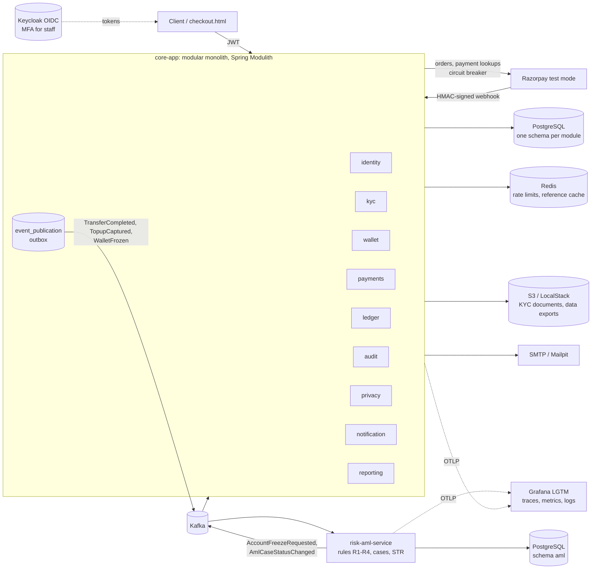

# TrustLedger

**A regulated digital wallet with a double-entry ledger, KYC, AML monitoring and a tamper-evident audit trail.**
Customers complete KYC, add money through Razorpay, and send it to each other. Every rupee is a balanced, append-only
journal entry. Two different compliance officers approve each full KYC. A separate AML service watches every money
movement over Kafka and freezes a wallet on its own when a high-risk rule fires. Every action lands in a SHA-256
hash chain that an auditor can verify. Java 25 and Spring Boot 4: a modular monolith (Spring Modulith) plus one
event-driven microservice, with all tests running against real infrastructure in containers.

> Portfolio project. All users and data are fake, and payments use Razorpay **test mode** only.

## 1. Demo

- **Demo video (5 minutes):** _link coming_. The script is ready: [docs/demo-script.md](docs/demo-script.md).
- **Live URL:** none yet. The AWS deployment is not built ([Not yet built](#not-yet-built)).
- **Try it locally in three commands:** [section 7](#7-run-locally-in-3-commands), then the request tour
  [http/demo.http](http/demo.http).

## 2. Architecture



**core-app** (port 8080) is one deployable with ten modules. Each is a top-level package with a public `*Api`
interface and events, and internal `web → application → domain` layers:

| Module | Owns |
| --- | --- |
| `shared` | Money, errors (RFC 9457 ProblemDetail), security, crypto, correlation IDs, outbox externalization |
| `identity` | Users (JIT-provisioned from the Keycloak token), consents |
| `kyc` | Minimum and full KYC cases, documents in S3, maker-checker review |
| `wallet` | Wallets, tier limits, freezes (officer and AML), nightly reconciliation |
| `ledger` | Accounts, append-only journal entries and lines, reversals. Depends on no other business module |
| `payments` | P2P transfers, high-value review, idempotency keys, Razorpay top-ups and webhooks |
| `audit` | The hash-chained audit trail and its verification |
| `privacy` | Data export and erasure (DPDP) |
| `notification` | E-mails on business events |
| `reporting` | Transaction history |

**risk-aml-service** (port 8081) is a separate Spring Boot app with its own schema. It only hears about money from
Kafka and only acts through Kafka, so an AML outage delays analysis but never a payment
([ADR 0007](docs/adr/0007-separate-aml-service.md)). `event-contracts` holds the versioned Kafka records and nothing
else.

## 3. Compliance features and the rules they implement

| Area | Rule (real-world source; values to re-verify before production) | How TrustLedger implements it | Proof |
| --- | --- | --- | --- |
| **KYC tiers** | RBI Master Directions on PPIs: small PPIs after minimum KYC, full-KYC PPIs after address and documents | Minimum KYC (PAN, DOB, mobile) opens a **MIN** wallet. Full KYC (address + PAN card and address proof in S3) upgrades it to **FULL** | `MinKycIT`, `FullKycIT`, `KycLevelUpgradedScenarioIT` |
| **PPI limits** | RBI PPI limits per tier | MIN: balance ₹10,000, ₹10,000 loaded a month, **no P2P**. FULL: balance ₹2,00,000, ₹2,00,000 a month, P2P with daily (₹1,00,000) and monthly limits. Configuration, validated at startup | `TransferServiceIT`, `LimitsPropertiesTest` |
| **High-value review** | Enhanced scrutiny of large transfers | ₹50,000 or more is **held** until an officer approves (money moves then) or rejects (hold released) | `HeldTransferServiceIT` |
| **Maker-checker** | Four-eyes principle for KYC approval | Officer A verifies, a **different** officer B approves. Enforced in code and by a database check | `ComplianceKycIT` |
| **AML monitoring** | PMLA: transaction monitoring and suspicious transaction reports (STR) | R1 velocity (>5 transfers in 10 min), R2 structuring (3+ of ₹45,000–49,999.99 in 24 h), R3 large amount (≥ ₹1,00,000), R4 fan-out (10+ recipients in 24 h). HIGH alerts **freeze the wallet automatically**. Cases: OPEN → INVESTIGATING → closed as false positive or ESCALATED with an STR CSV export | `*RuleTest`, `RuleEngineIT`, `AccountFreezeRequestedConsumerIT` |
| **Freeze** | Regulator or compliance hold | Officers freeze and unfreeze with a reason. A frozen wallet can't send, receive or top up | `WalletAuditedActionsIT` |
| **Audit trail** | Regulatory record keeping | Every state change and every officer or admin action writes a SHA-256 **hash-chained**, append-only row. `/audit/verify` finds the first broken link | `AuditTrailIT`, `AuditApiIT` |
| **Data protection (DPDP Act 2023)** | Consent, minimisation, access and erasure rights | Versioned consent history. PAN, DOB, address, phone, e-mail **AES-256-GCM encrypted** with HMAC blind indexes, masked in every response and log. Data export (JSON in S3, presigned link). **Erasure** removes personal data but keeps the ledger, transfers and audit trail; KYC records stay for the 5-year PMLA retention | `ErasureIT`, `ConsentsIT` |
| **PCI DSS scope** | Card data handling | **Out of scope by design:** card details are entered only in Razorpay Checkout and never reach our servers. We store order and payment IDs | Architecture (no card fields anywhere) |
| **Payment integrity** | Gateway notifications must be authentic | Webhooks are verified by HMAC-SHA256 over the raw body in constant time, stored, and de-duplicated by event ID | `RazorpayWebhookControllerIT`, `TopupWebhookSettlementIT` |

## 4. Engineering highlights

- **Idempotency keys:** `POST /transfers` and `/topups` need an `Idempotency-Key`. A retry returns the stored first
  response (`Idempotent-Replayed: true`). The same key with another body gets 422, and a retry during the first
  request gets 409. Money never moves twice.
- **Ordered pessimistic locking:** both wallets are locked with `SELECT … FOR UPDATE` in ascending ID order *as
  PostgreSQL sorts UUIDs*, so opposite transfers can't deadlock. 100 concurrent transfers never overdraw
  ([ADR 0004](docs/adr/0004-pessimistic-locking.md)).
- **Double-entry ledger:** every movement is one balanced journal entry, enforced by a deferred database trigger.
  The journal is append-only (UPDATE and DELETE are refused by triggers). A unique business reference makes a
  second posting impossible. A nightly reconciliation compares every cached balance with the ledger.
- **Transactional outbox:** events are stored in the same transaction as the money movement (Spring Modulith's
  registry) and externalized to Kafka with fixed event IDs. Only versioned contracts leave the app
  ([ADR 0005](docs/adr/0005-outbox-with-spring-modulith.md)).
- **Idempotent consumers:** each Kafka event is claimed in `processed_events` in the same transaction as its effect.
  Three attempts with backoff, then a dead-letter topic. Unreadable records go straight to the DLT.
- **Hash-chained audit:** canonical JSON → SHA-256 chained to the previous row, written before commit in the
  business transaction under an advisory lock. Unique `prev_hash` makes forks impossible
  ([ADR 0008](docs/adr/0008-hash-chained-audit.md)).
- **Field encryption:** AES-256-GCM per column with a random IV, plus keyed HMAC blind indexes for the fields we look
  up ([ADR 0009](docs/adr/0009-field-encryption.md)).
- **Also:** Keycloak with MFA by role, deny-by-default security with one rule per endpoint, BOLA-safe 404s, per-user
  rate limits (Bucket4j on Redis), Razorpay calls outside transactions behind a circuit breaker, ShedLock for
  scheduled jobs, OpenTelemetry traces across both services, non-root container images.

## 5. Tech stack

| Layer | Choice |
| --- | --- |
| Language, framework | Java 25, Spring Boot 4.1, Spring Modulith 2.1, Spring Security 7 (OAuth2 resource server) |
| Identity | Keycloak 26 (OIDC, MFA by role), realm as code |
| Data | PostgreSQL 17, Spring Data JPA, Flyway (`ddl-auto=validate`), Redis 8 |
| Messaging | Apache Kafka 4.4 (KRaft), Spring Kafka, Spring Modulith event externalization |
| Payments | Razorpay (test mode), Resilience4j |
| Storage, mail | AWS SDK v2 S3 (LocalStack locally), Spring Mail (Mailpit locally) |
| Observability | OpenTelemetry over OTLP, Grafana LGTM (Tempo, Loki, Prometheus) |
| Tests | JUnit 5, AssertJ, Mockito, Testcontainers, WireMock, ArchUnit, JaCoCo, k6 |
| Web app | React 19, TypeScript (strict), Vite, React Router, TanStack Query, Tailwind + shadcn/ui, react-oidc-context (PKCE); Vitest, MSW, Playwright |
| Delivery | Multi-stage Dockerfiles, GitHub Actions (verify, Trivy, gitleaks, frontend, image build) |

## 6. Repository map

| Path | What |
| --- | --- |
| [core-app/](core-app/) | The modular monolith |
| [risk-aml-service/](risk-aml-service/) | The AML service |
| [frontend/](frontend/) | The web app (React + TypeScript, Day 29+) |
| [event-contracts/](event-contracts/) | Kafka contracts (`…V1` records) |
| [infra/](infra/) | Docker Compose, the Keycloak realm, the Grafana dashboard |
| [http/](http/) | Request collection for **every** endpoint ([index](http/README.md)) |
| [scripts/](scripts/) | `smoke.sh`, AML demo helper |
| [load-tests/](load-tests/) | k6 load test and perf users |
| [docs/](docs/) | [Spec](docs/SPEC.md), [ADRs](docs/adr/), [performance](docs/perf.md), [security checklist](docs/security-checklist.md), [AML demo](docs/aml-demo.md), [Razorpay end-to-end test](docs/e2e-razorpay.md) |

## 7. Run locally in 3 commands

From this directory (`dev/`), with Docker Desktop running and Git Bash:

```bash
cp .env.example .env    # then replace every change-me (keys: openssl rand -base64 32; Razorpay TEST keys)
docker compose -f infra/docker-compose.yml --profile apps up -d --build
scripts/smoke.sh        # health, token, /me, one ₹1.00 transfer and its idempotent replay
```

The `apps` profile starts the infrastructure (PostgreSQL, Redis, Kafka, Keycloak, LocalStack, Mailpit) and both apps
from their images. The first build downloads every Maven dependency (about 10 minutes); later ones take seconds.
core-app runs with the Spring profile **`demo`**, which seeds **customer1 (₹50,000) and customer2 (₹10,000)** with
approved FULL KYC and ledger-backed balances. You can send money straight away, without a KYC review or a Razorpay
payment first. Then walk through [http/demo.http](http/demo.http).

> A Keycloak container created before this version still has random IDs for customer1/customer2. Recreate it once:
> `docker compose -f infra/docker-compose.yml up -d --force-recreate keycloak` (then re-run
> `load-tests/keycloak-perf-users.sh` if you use the load test).

**Developing instead** (apps on the host, hot restart):

```bash
docker compose -f infra/docker-compose.yml up -d
./mvnw install -DskipTests                                                   # once
./mvnw -pl core-app spring-boot:run -Dspring-boot.run.profiles=local,demo    # or just local: no seed
./mvnw -pl risk-aml-service spring-boot:run -Dspring-boot.run.profiles=local
```

> **PowerShell:** quote `-D` arguments that contain a dot: `"-Dspring-boot.run.profiles=local,demo"`.

| Service | URL |
| --- | --- |
| core-app API | http://localhost:8080/api/v1 |
| risk-aml-service API | http://localhost:8081/api/v1 |
| Swagger UI, core (local profile) | http://localhost:8080/swagger-ui.html |
| Swagger UI, AML (local profile) | http://localhost:8081/swagger-ui.html |
| Test checkout (local profile) | http://localhost:8080/checkout.html |
| Keycloak | http://localhost:8180 |
| Mailpit | http://localhost:8025 |
| Grafana (compose profile `obs`) | http://localhost:3000 |

**Test users** (fake, local only; password `TRUSTLEDGER_DEV_USER_PASSWORD` from `.env`): customer1, customer2
(CUSTOMER), officer1, officer2 (COMPLIANCE_OFFICER, **TOTP required**), admin1 (ADMIN, **TOTP required**), auditor1
(AUDITOR). `scripts/aml-demo-webhooks.sh totp` prints the current staff code. Details in
[Local authentication](#local-authentication-keycloak).

### Web app

With the stack above running (core-app with `local,demo`, the AML service with `local`):

```bash
cd frontend
npm ci
npm run dev          # http://localhost:5173; local defaults in src/config.ts
```

Sign in as any test user: each role gets its own navigation. Tokens stay in memory (never localStorage), so a page
reload goes back through Keycloak, which signs you straight back in. Frontend tests: `npm run ci` (lint, type-check,
Vitest, build), `npm run e2e` (Playwright, no backend needed) and `npm run e2e:stack` (a real login; export
`TRUSTLEDGER_DEV_USER_PASSWORD` first). Rules in [ADR 0023](docs/adr/0023-frontend-stack.md).

## 8. Tests

```bash
./mvnw verify                    # everything; Testcontainers starts PostgreSQL, Redis, Kafka, Keycloak, LocalStack
./mvnw verify -DskipUnitTests    # integration tests only
```

**2,370 tests, all green** (2026-11-23): core-app 1,344 unit + 816 integration,
risk-aml-service 112 unit + 62 integration, event-contracts 36. Integration
tests run against real PostgreSQL, Kafka, Redis, Keycloak and LocalStack containers. There is no H2 and no mocked
database.

**Coverage** (JaCoCo, unit + integration combined, from `target/site/jacoco/` after `./mvnw verify`):

| Module | Lines | Branches | Instructions |
| --- | --- | --- | --- |
| core-app | 96.6% (5,143 of 5,324) | 89.1% | 96.6% |
| risk-aml-service | 94.1% (962 of 1,022) | 85.1% | 95.3% |
| event-contracts | 100% (52 of 52) | 100% | 100% |

**The must-pass list** (SPEC §9), and the tests that prove each point:

| # | Must pass | Tests |
| --- | --- | --- |
| 1 | An unbalanced journal entry is rejected by the service and by the database | `LedgerPostingServiceIT`, `LedgerMigrationIT` |
| 2 | UPDATE and DELETE on ledger and audit tables fail | `LedgerMigrationIT`, `AuditMigrationIT` |
| 3 | Same `Idempotency-Key` returns the original response; same key, other body → 422 | `IdempotencyInterceptorIT`, `IdempotencyServiceIT` |
| 4 | 100 concurrent transfers never overdraw; reconciliation finds no mismatch | `TransferConcurrencyIT` (runs the real `ReconciliationJob` at the end) |
| 5 | Opposite concurrent transfers never deadlock | `DeadlockFreedomIT` |
| 6 | Every transfer rejection rule returns the right error code | `TransferServiceIT`, `TransferMonthlyLimitIT` |
| 7 | A high-value transfer is held, then approved or rejected exactly once | `HeldTransferServiceIT` |
| 8 | Duplicate and invalid-signature webhooks are handled safely | `RazorpayWebhookControllerIT`, `TopupWebhookSettlementIT` |
| 9 | A gateway timeout opens the circuit breaker and returns 503 | `RazorpayGatewayAdapterTest` (timeouts alone open it), `TopupControllerIT` |
| 10 | KYC maker and checker must be different officers | `ComplianceKycIT`, `KycReviewServiceTest` |
| 11 | 401/403/200 for every endpoint × role; no BOLA | `SecurityMatrixIT`, `AmlSecurityIT` |
| 12 | Each AML rule fires at its threshold, not just below; HIGH freezes the wallet | `VelocityRuleTest`, `StructuringRuleTest`, `LargeAmountRuleTest`, `FanOutRuleTest`, `RuleEngineIT`, `AccountFreezeRequestedConsumerIT` |
| 13 | A duplicate Kafka event is processed once; a poison message goes to the DLT | `TransactionFactConsumerIT` |
| 14 | Tampering with an audit row is detected by `/audit/verify` | `AuditApiIT` |
| 15 | Erasure removes personal data and keeps financial records | `ErasureIT` |
| 16 | Module boundaries hold | `ModularityTests`, `ArchitectureRulesTest` |

Also guarded: `ContainerImageTest` (Dockerfiles and the CI image job), `HttpCollectionTest` (every endpoint has a
request in [http/](http/)), `DemoSeederIT` (the demo seed is ledger-backed and idempotent).

## 9. Performance and security

- **Performance:** [docs/perf.md](docs/perf.md). k6 against 200 seeded wallets with real Keycloak tokens: **p99
  82 ms at 10 transfers/s**, 397 ms at 50/s. The SPEC target (p99 < 300 ms at 100/s) is **not met** on a laptop: the
  app tops out at about 55–80 transfers per second. No request failed, and no money drifted under load. The
  history query was tuned with `EXPLAIN ANALYZE` (one finding: a `WHERE` on a `UNION ALL` branch forced a sort).
- **Security:** [docs/security-checklist.md](docs/security-checklist.md) maps the OWASP API Security Top 10 (2023) to
  our controls and the tests that prove them. CI scans dependencies (Trivy) and history for secrets (gitleaks), from
  digest-pinned images ([ADR 0021](docs/adr/0021-ci-dependency-and-secret-scanning.md)).

## 10. Design decisions

| ADR | Decision |
| --- | --- |
| [0001](docs/adr/0001-modular-monolith.md) | Modular monolith with Spring Modulith for the core, a separate AML service |
| [0002](docs/adr/0002-keycloak-instead-of-custom-auth.md) | Keycloak (OIDC) instead of custom authentication; MFA by role |
| [0003](docs/adr/0003-money-as-minor-units.md) | Money as `long` paise, never floating point |
| [0004](docs/adr/0004-pessimistic-locking.md) | Pessimistic row locks in ascending ID order for money movement |
| [0005](docs/adr/0005-outbox-with-spring-modulith.md) | Transactional outbox with Spring Modulith's event publication registry |
| [0006](docs/adr/0006-over-limit-topups.md) | Captured top-ups a wallet can't take are parked in suspense |
| [0007](docs/adr/0007-separate-aml-service.md) | AML as a separate service with idempotent Kafka consumers |
| [0008](docs/adr/0008-hash-chained-audit.md) | Hash-chained, append-only audit trail written in the business transaction |
| [0009](docs/adr/0009-field-encryption.md) | Field-level encryption with blind indexes, and erasure |
| [0010](docs/adr/0010-springdoc-openapi.md) | springdoc-openapi for the API description |
| [0011](docs/adr/0011-aws-sdk-s3-document-storage.md) | AWS SDK v2 (S3 only) for KYC document storage |
| [0012](docs/adr/0012-spring-modulith-events-api.md) | Spring Modulith events API for module listeners |
| [0013](docs/adr/0013-shedlock-for-scheduled-jobs.md) | ShedLock for scheduled jobs |
| [0014](docs/adr/0014-gateway-resilience-and-wiremock.md) | Razorpay client resilience (Resilience4j) and WireMock for gateway tests |
| [0015](docs/adr/0015-archunit-architecture-rules.md) | ArchUnit for the rules inside a module |
| [0016](docs/adr/0016-mapping-without-mapstruct.md) | Mapping with static factories on records, not MapStruct |
| [0017](docs/adr/0017-email-via-javamailsender.md) | Notification e-mails through JavaMailSender over SMTP |
| [0018](docs/adr/0018-aspectj-for-audited-endpoints.md) | AspectJ for the `@Audited` endpoint aspect |
| [0019](docs/adr/0019-redis-cache-for-reference-data.md) | Redis cache for reference data only; balances are never cached |
| [0020](docs/adr/0020-opentelemetry-otlp-observability.md) | OpenTelemetry over OTLP to Grafana LGTM |
| [0021](docs/adr/0021-ci-dependency-and-secret-scanning.md) | Trivy and gitleaks in CI, pinned by image digest |
| [0022](docs/adr/0022-container-images.md) | Multi-stage Dockerfiles, layered jar, non-root, images built in CI |
| [0023](docs/adr/0023-frontend-stack.md) | React web app: OIDC Authorization Code + PKCE, tokens in memory, one API client |

ADRs 0001–0009 were checked against the code on 2026-11-23. Each ends with a "Code check" note that names what
still differs.

## Not yet built

Deliberately cut or postponed, in the order SPEC §12 says to cut them:

- **AWS deployment** (second half of M14): ECR push, ECS/RDS/MSK, KMS envelope encryption for the field key, a
  live URL. CI builds the images but pushes nowhere.
- **PDF statements** (FR-S-2, `GET /wallets/me/statements/{yyyy-MM}`): history exists, the PDF doesn't (404).
- **Hibernate Envers** entity history (M10). The hash-chained audit trail covers who changed what; Envers would add
  full row versions.
- **AI case summary** (optional M15, `POST /aml/cases/{id}/ai-summary`): refused by the deny-all rule.
- Smaller gaps, each recorded in its ADR: `lock_timeout` on money transactions, alerts on DLT traffic, parked top-ups
  and stale outbox rows, disabling the Keycloak account of an erased customer, the 300 ms p99 target at 100
  transfers/s.

---

## More detail

### The money path

- **Wallets:** minimum KYC opens a MIN wallet. Full KYC upgrades it to FULL. Limits are configuration
  (`trustledger.limits.*`), validated at startup. Available balance = balance − held.
- **Ledger accounts:** `WALLET:<id>` (what we owe the customer), `PLATFORM:GATEWAY_CLEARING` (money held at Razorpay),
  `PLATFORM:SUSPENSE` (captured money a wallet can't take: frozen, over a limit;
  [ADR 0006](docs/adr/0006-over-limit-topups.md)). Mistakes are fixed with reversal entries, never edits.
- **Transfers** (`POST /api/v1/transfers`): one transaction, wallets locked in ID order, then the checks (KYC tier,
  wallet status, available balance, daily and monthly limits, receiver's cap). ₹50,000 or more → `HELD_FOR_REVIEW`.
  Only the sender or receiver can read a transfer; anyone else gets the same 404 as an unknown ID.
- **Top-ups** (`POST /api/v1/topups`): the Razorpay order is created outside any transaction (circuit breaker,
  timeout). The customer pays in Razorpay Checkout. The signed `payment.captured` webhook credits the wallet:
  Dr GATEWAY_CLEARING / Cr WALLET in one transaction. If a webhook is lost, a reconciler asks Razorpay every 5
  minutes. A real test-mode payment through a tunnel: [docs/e2e-razorpay.md](docs/e2e-razorpay.md).
- **AML demo:** three ₹46,000 top-ups → R2 structuring → the wallet freezes by itself → the officer escalates and
  exports the STR: [docs/aml-demo.md](docs/aml-demo.md) and [http/aml-demo.http](http/aml-demo.http).

### Observability

Grafana LGTM runs in the compose profile `obs`. The apps export to it when they also run with the Spring profile
`obs` ([ADR 0020](docs/adr/0020-opentelemetry-otlp-observability.md)):

```bash
docker compose -f infra/docker-compose.yml --profile obs up -d
./mvnw -pl core-app spring-boot:run -Dspring-boot.run.profiles=local,obs
./mvnw -pl risk-aml-service spring-boot:run -Dspring-boot.run.profiles=local,obs
```

Grafana at http://localhost:3000 → Explore. In **Tempo**, one transfer trace shows the HTTP request, the Kafka send
and risk-aml-service's consumer span. In **Loki** (`{service_name="core-app"}`), every line carries `trace_id` and
links to its trace. The provisioned dashboard **TrustLedger overview**
(http://localhost:3000/d/trustledger-overview, from
[infra/grafana/trustledger-dashboard.json](infra/grafana/trustledger-dashboard.json)) shows:
- request and error rates, and p95/p99 per endpoint;
- transfers by status and amount, and top-ups by status;
- the Razorpay circuit state;
- AML alerts by rule;
- reconciliation mismatches (anything above 0 is a bug).

**Actuator** (both apps): `/actuator/health`, `/health/liveness` and `/health/readiness` are public and show only the
status. Health components, `/actuator/metrics` and `/actuator/info` need an ADMIN token.

### Container images and the smoke test

Both apps have multi-stage Dockerfiles: a layered jar on a Temurin 25 JRE, a non-root user (uid 10001), and a
HEALTHCHECK on `/actuator/health` ([ADR 0022](docs/adr/0022-container-images.md)). CI builds both on every push to
`master`, after the tests and scans pass. [scripts/smoke.sh](scripts/smoke.sh) checks a running stack:
- health of both apps and Keycloak;
- a token and `/me`;
- one transfer, checking that the balance changed exactly once and the replay moved nothing.

It exits non-zero at the first failure. `SMOKE_SENDER`/`SMOKE_RECIPIENT` switch the users (for example the perf
users).

### Load test

k6 drives `POST /transfers` between 200 seeded wallets (Spring profile `perf`) with real Keycloak tokens:
[load-tests/README.md](load-tests/README.md). Starting the AML service in front of a load test's events replays them
through the real rules. Expect R4 fan-out alerts and frozen perf wallets.

### Local authentication (Keycloak)

The realm `trustledger` is imported from [infra/keycloak/realm-trustledger.json](infra/keycloak/realm-trustledger.json)
when the container is **created**. After changing the realm file or the `TRUSTLEDGER_DEV_*` values in `.env`:

```bash
docker compose -f infra/docker-compose.yml up -d --force-recreate keycloak
```

| Client | Type | Use |
| --- | --- | --- |
| `trustledger-web` | Public, authorization code + PKCE (S256) | The browser app. No password grant. |
| `trustledger-dev` | Public, password grant | **Local testing only** ([http/](http/), `smoke.sh`). Must never exist outside a developer machine. |

- **OTP** (TOTP, 6 digits, 30 s) is required **by role** for compliance officers and admins, in both the browser
  login and the password grant. officer1, officer2 and admin1 share the secret `TRUSTLEDGER_DEV_TOTP_SECRET`. A code
  works once.
- **Brute-force protection** is on.
- **Tokens:** access tokens live 5 minutes, and refresh tokens rotate.
- **Users:** customer1 and customer2 have fixed Keycloak IDs, so the `demo` seed finds them.

With curl:

```bash
TOKEN=$(curl -s http://localhost:8180/realms/trustledger/protocol/openid-connect/token \
  -d grant_type=password -d client_id=trustledger-dev -d username=customer1 \
  --data-urlencode "password=$TRUSTLEDGER_DEV_USER_PASSWORD" | sed -E 's/.*"access_token":"([^"]+)".*/\1/')
curl -s http://localhost:8080/api/v1/me -H "Authorization: Bearer $TOKEN"
```

The first authenticated request creates the user row (just-in-time provisioning). Personal data is stored encrypted
and returned masked. Rate limits per user:
- 20 requests a minute on `POST /transfers` and `/topups` together;
- 100 a minute on everything else.

Above that the API returns 429 `RATE_LIMITED` with `Retry-After`.
