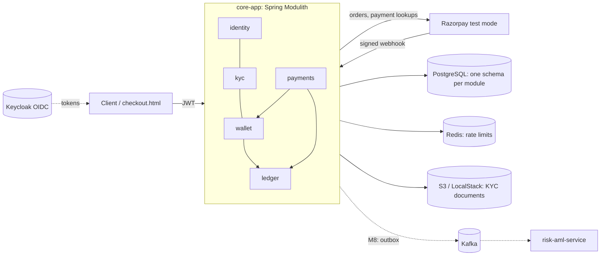

# TrustLedger

A regulated digital wallet with a double-entry ledger, KYC, AML monitoring and a tamper-evident audit trail.
Java 25, Spring Boot 4 (a modular monolith with Spring Modulith) plus a separate risk/AML service over Kafka.
Portfolio project: all users and data are fake, and payments use Razorpay **test mode** only.

- Specification: [docs/SPEC.md](docs/SPEC.md)
- Design decisions: [docs/adr/](docs/adr/)
- Manual end-to-end payment test: [docs/e2e-razorpay.md](docs/e2e-razorpay.md)

> **Status (Day 14):** the core money path is built: identity, KYC, wallet, ledger, P2P transfers, and top-ups
> through Razorpay (milestones M0–M7). Still to come: Kafka outbox (M8), the AML service (M9), audit and privacy
> (M10), statements (M11), observability, hardening and AWS (M12–M14). This README grows with them. The full
> version (demo video, compliance mapping, performance numbers) arrives in M16.

## The money path

Every rupee is stored as `long` paise in a `Money` record (never `double`), sent over the API as a decimal
string (`"1500.50"`), and backed by a balanced double-entry journal entry.

### Wallets and KYC tiers

- Minimum KYC (fake PAN, mobile, date of birth) opens a **MIN** wallet: balance cap ₹10,000, monthly load
  ₹10,000, no P2P. Full KYC (address + documents, checked by **two different officers**: maker-checker) upgrades
  it to **FULL**: cap ₹2,00,000, P2P allowed, daily and monthly transfer limits.
- Limits are configuration (`trustledger.limits.*`), validated at startup.
- Compliance officers can freeze and unfreeze a wallet, with a reason. A frozen wallet can't send or receive.

### Double-entry ledger

- Accounts: `WALLET:<id>` (what we owe the customer), `PLATFORM:GATEWAY_CLEARING` (money held at Razorpay),
  `PLATFORM:SUSPENSE` (captured money we can't credit yet).
- `journal_entries` and `journal_lines` are **append-only** (database triggers refuse UPDATE/DELETE). A
  deferred constraint trigger refuses any entry whose debits ≠ credits. Mistakes are fixed with a reversal entry.
- `UNIQUE (reference_type, reference_id, entry_type)` makes a second posting of the same business event
  impossible, even under races.
- A **nightly reconciliation** (and `POST /api/v1/admin/reconciliation/run`) checks every wallet's cached
  balance against its ledger account.

### P2P transfers: `POST /api/v1/transfers`

- **`Idempotency-Key` required.** A retry with the same key and body returns the first response
  (`Idempotent-Replayed: true`). The same key with a different body → 422 `IDEMPOTENCY_KEY_REUSED`. A retry
  while the first request is still running → 409 `REQUEST_IN_PROGRESS`.
- **One database transaction.** Both wallets are locked with `SELECT … FOR UPDATE` **in ascending ID order**,
  so two opposite transfers can't deadlock (ADR 0004). No remote call happens while the locks are held.
- Checks: KYC tier, wallet status, available balance, daily and monthly limits, the receiver's balance cap.
- At or above the high-value threshold (₹50,000), the amount is **held** (`HELD_FOR_REVIEW`). A compliance
  officer approves (posting happens then) or rejects (hold released).
- Only the sender or receiver can read a transfer. Anyone else gets the same 404 as an unknown ID (no BOLA).

### Top-ups through Razorpay (test mode): `POST /api/v1/topups`

1. Create: limits are checked, a Razorpay order is created **outside any transaction** (circuit breaker +
   timeout, ADR 0014), and the top-up is PENDING. The response has the `gatewayOrderId` and `keyId`.
2. The customer pays in Razorpay Checkout (`/checkout.html`, local profile only).
3. `POST /api/v1/webhooks/razorpay` (public): HMAC-SHA256 over the **raw body**, compared in constant time.
   Every delivery is stored, accepted or rejected, and duplicates are processed once.
4. `payment.captured` → limits re-checked → **Dr GATEWAY_CLEARING / Cr WALLET:<id>**, wallet credited, top-up
   CAPTURED, all in one transaction with marking the event processed. If a limit no longer fits, the money is
   **parked** in SUSPENSE instead of being lost or refused (ADR 0006).
5. If a webhook is lost: every 5 minutes, `PendingTopupReconciler` asks Razorpay about top-ups still PENDING
   after 15 minutes. Captured → credited. Nothing captured after 24 hours → EXPIRED.

## Architecture



Modules: `shared`, `identity`, `kyc`, `wallet`, `ledger`, `payments` (built); `audit`, `privacy`, `notification`,
`reporting` (later). Modules talk only through their `*Api` interface or events, and `ledger` depends on no other
business module. `ModularityTests` (Spring Modulith `verify`) and `ArchitectureRulesTest` (ArchUnit: layers, `@Transactional` placement, `Clock`-only time, no floating point, records for DTOs) enforce this on every build.

## Run locally

From this directory (`dev/`), with Docker Desktop running:

```bash
cp .env.example .env            # then replace every change-me (see comments in the file)
docker compose -f infra/docker-compose.yml up -d
./mvnw install -DskipTests      # once
./mvnw -pl core-app spring-boot:run -Dspring-boot.run.profiles=local
```

> **PowerShell:** quote `-D` arguments that contain a dot: `"-Dspring-boot.run.profiles=local"`.

| Service | URL |
| --- | --- |
| core-app API | http://localhost:8080/api/v1 |
| Swagger UI (local profile) | http://localhost:8080/swagger-ui.html |
| Test checkout (local profile) | http://localhost:8080/checkout.html |
| Keycloak | http://localhost:8180 |
| Mailpit | http://localhost:8025 |
| Grafana (compose profile `obs`) | http://localhost:3000 |

### Observability (traces, metrics, logs)

Grafana LGTM (Tempo, Loki, Prometheus-compatible metrics) runs in the compose profile `obs`; the apps export to it over
OTLP when they also run with the Spring profile `obs` ([ADR 0020](docs/adr/0020-opentelemetry-otlp-observability.md)):

```bash
docker compose -f infra/docker-compose.yml --profile obs up -d
./mvnw -pl core-app spring-boot:run -Dspring-boot.run.profiles=local,obs
./mvnw -pl risk-aml-service spring-boot:run -Dspring-boot.run.profiles=local,obs
```

Open Grafana at http://localhost:3000 → Explore. **Tempo**: search by service `core-app` and open a transfer trace;
the Kafka send and risk-aml-service's consumer span are in the same trace. **Loki**: `{service_name="core-app"}`;
each line carries `trace_id`/`span_id` and links to its trace. Without `obs`, tracing still runs (trace and span IDs
on every console line) but nothing is exported.

**Dashboard:** Grafana → Dashboards → folder *TrustLedger* → **TrustLedger overview**
(http://localhost:3000/d/trustledger-overview). It is provisioned from
[infra/grafana/trustledger-dashboard.json](infra/grafana/trustledger-dashboard.json); edit that file, not the UI, and
Grafana reloads it within 30 s. Metrics arrive every 15 s, so a new panel value can take up to half a minute.

| Panel | Prometheus metric | Meaning |
| --- | --- | --- |
| Request rate, error rate | `http_server_requests_seconds_count` | per service; error rate split into 5xx and 4xx |
| p95 / p99 latency per endpoint | `http_server_requests_seconds_bucket` | per method and URI template |
| Transfers by status | `trustledger_transfers_total{status}` | state changes: COMPLETED, HELD_FOR_REVIEW, then COMPLETED/REJECTED on review, FAILED when refused |
| Transfer amount distribution | `trustledger_transfer_amount_bucket` | rupee buckets; 45k–50k is AML rule R2's band, 1L rule R3's |
| Top-ups by status | `trustledger_topups_total{status}` | PENDING, CAPTURED, PARKED, FAILED, EXPIRED |
| Payment gateway circuit | `trustledger_gateway_circuit_state{name,state}` | Razorpay circuit breaker: CLOSED, HALF_OPEN, OPEN |
| AML alerts by rule | `trustledger_aml_alerts_total{rule}` | from risk-aml-service: R1 velocity, R2 structuring, R3 large amount, R4 fan-out |
| Reconciliation mismatches | `trustledger_reconciliation_mismatches_total{reason}` | anything above 0 is a bug (FR-L-4) |

**Actuator** (both apps): `/actuator/health`, `/actuator/health/liveness` and `/actuator/health/readiness` are public
and show only the status. Health components, `/actuator/metrics` and `/actuator/info` need an ADMIN token; everything
else under `/actuator` is not exposed.

### Run the container images and the smoke test

Both apps have multi-stage Dockerfiles: a layered jar on a Temurin 25 JRE, a non-root user, and a HEALTHCHECK on
`/actuator/health` ([ADR 0022](docs/adr/0022-container-images.md)). The compose profile `apps` builds and runs them
against the same local infrastructure. Stop any `spring-boot:run` first, since they use the same ports:

```bash
docker compose -f infra/docker-compose.yml --profile apps up -d --build
docker compose -f infra/docker-compose.yml ps            # core-app and risk-aml-service become "healthy"
scripts/smoke.sh                                         # Git Bash; also works against spring-boot:run
```

[scripts/smoke.sh](scripts/smoke.sh) checks health (both apps and Keycloak), gets a token, calls `/me`, runs one
₹1.00 transfer and its idempotent replay, and exits non-zero at the first failure. It needs two FULL-tier test users
that aren't frozen. The defaults are customer1 → customer2; the header shows how to use the seeded `perf001` →
`perf002` instead. CI builds both images on every push to `master`, after the tests and scans pass. Nothing is pushed
to a registry yet.

### Try the money path

IntelliJ HTTP Client files in [http/](http/) (environment `local`), in this order:

1. [auth.http](http/auth.http): tokens, profile, consents, minimum KYC for customer1 (opens a MIN wallet).
2. [wallet.http](http/wallet.http): own wallet; freeze/unfreeze as an officer.
3. [kyc.http](http/kyc.http): full KYC with documents, verify (officer1) and approve (officer2) → FULL wallet.
4. [transfers.http](http/transfers.http): P2P transfers, idempotent retry, limits, high-value hold and review.
5. [topups.http](http/topups.http) + [docs/e2e-razorpay.md](docs/e2e-razorpay.md): a real test-mode payment
   through a tunnel, the webhook, then the balance and journal entry in SQL.

## Tests

```bash
./mvnw verify                    # everything (Testcontainers starts PostgreSQL, Redis, Keycloak, LocalStack)
./mvnw verify -DskipUnitTests    # integration tests only
```

About 1,000 unit tests and 590 integration tests, all against real infrastructure in containers (no H2).
Money paths are tested for the happy path, each rejection rule, idempotent retry and concurrency, for example:
- concurrent opposite transfers never deadlock, and balances never drift (`DeadlockFreedomIT`,
  `TransferConcurrencyIT`);
- a duplicate webhook credits once, and a webhook racing the reconciler credits once (`TopupWebhookSettlementIT`,
  `PendingTopupReconcilerIT`);
- every endpoint × role combination (`SecurityMatrixIT`).

### Load test (M13)

k6 drives `POST /transfers` between 200 seeded wallets (profile `perf`) with real Keycloak tokens. Setup and commands:
[load-tests/README.md](load-tests/README.md). Measured results: [docs/perf.md](docs/perf.md) §2. On a laptop, p99 is
82 ms at 10 req/s. The 300 ms target at 100 req/s is **not met yet**: the app tops out at about 55 to 80 transfers per
second. No request failed and no money drifted.

## Tech stack

Java 25 · Spring Boot 4 · Spring Security 7 (OAuth2 resource server, Keycloak) · Spring Data JPA · PostgreSQL ·
Flyway · Spring Modulith · Redis + Bucket4j · Resilience4j · ShedLock · springdoc-openapi · AWS SDK v2 (S3) ·
Kafka (M8) · OpenTelemetry + Grafana LGTM (M12) · Testcontainers · WireMock · ArchUnit · JUnit 5 · Mockito · AssertJ.

## Design decisions

| ADR | Decision |
| --- | --- |
| [0001](docs/adr/0001-modular-monolith.md) | Modular monolith with Spring Modulith |
| [0002](docs/adr/0002-keycloak-instead-of-custom-auth.md) | Keycloak instead of custom authentication |
| [0003](docs/adr/0003-money-as-minor-units.md) | Money as `long` paise |
| [0004](docs/adr/0004-pessimistic-locking.md) | Pessimistic locking in ID order |
| [0006](docs/adr/0006-over-limit-topups.md) | Over-limit top-ups go to suspense |
| [0010](docs/adr/0010-springdoc-openapi.md) | springdoc-openapi |
| [0011](docs/adr/0011-aws-sdk-s3-document-storage.md) | AWS SDK v2 for KYC document storage |
| [0012](docs/adr/0012-spring-modulith-events-api.md) | Spring Modulith events API |
| [0013](docs/adr/0013-shedlock-for-scheduled-jobs.md) | ShedLock for scheduled jobs |
| [0014](docs/adr/0014-gateway-resilience-and-wiremock.md) | Gateway resilience and WireMock |
| [0015](docs/adr/0015-archunit-architecture-rules.md) | ArchUnit for the rules inside a module |
| [0016](docs/adr/0016-mapping-without-mapstruct.md) | Mapping with static factories, not MapStruct |
| [0020](docs/adr/0020-opentelemetry-otlp-observability.md) | OpenTelemetry over OTLP to Grafana LGTM |
| [0021](docs/adr/0021-ci-dependency-and-secret-scanning.md) | Trivy and gitleaks in CI, pinned by digest |
| [0022](docs/adr/0022-container-images.md) | Multi-stage Dockerfiles, layered jar, non-root, images built in CI |

Security review: [docs/security-checklist.md](docs/security-checklist.md) maps the OWASP API Security Top 10 (2023)
to our controls and the tests that prove them.

## Local authentication (Keycloak)

Keycloak runs at http://localhost:8180 (admin console login from `KC_BOOTSTRAP_ADMIN_*` in `.env`).
The realm `trustledger` is imported from [infra/keycloak/realm-trustledger.json](infra/keycloak/realm-trustledger.json)
when the container is **created**. After changing the realm file or the `TRUSTLEDGER_DEV_*` values
in `.env`, re-import with:

```bash
docker compose -f infra/docker-compose.yml up -d --force-recreate keycloak
```

### Clients

| Client | Type | Use |
| --- | --- | --- |
| `trustledger-web` | Public, authorization code + PKCE (S256) | The browser app (`http://localhost:5173`). No password grant. |
| `trustledger-dev` | Public, **direct access grants (password grant)** | **Local testing only**: [http/auth.http](http/auth.http) and manual tests. The password grant hands the user's password to the client, so this client must never exist outside a developer machine. |

### Test users (fake, local only)

All six use the password in `TRUSTLEDGER_DEV_USER_PASSWORD` from your `.env`.

| User | Role | OTP required |
| --- | --- | --- |
| customer1, customer2 | CUSTOMER | no |
| officer1, officer2 | COMPLIANCE_OFFICER | **yes** |
| admin1 | ADMIN | **yes** |
| auditor1 | AUDITOR | no |

OTP (TOTP, 6 digits, 30 s) is enforced **by role** for compliance officers and admins (FR-ID-4), in
both the browser login and the password grant. For local use, officer1, officer2 and admin1 already
have a TOTP credential whose secret is `TRUSTLEDGER_DEV_TOTP_SECRET` from `.env`. Authenticator apps
and `oathtool` expect the secret in base32:

```bash
printf '%s' "$TRUSTLEDGER_DEV_TOTP_SECRET" | base32          # add this to an authenticator app once
oathtool --totp -b "$(printf '%s' "$TRUSTLEDGER_DEV_TOTP_SECRET" | base32)"   # or print the current code
```

Notes:

- A code can be used only once. Wait for the next 30-second window to log in the same user again.
- Brute-force protection is on: two failed logins within one second, or five in a row, lock the user
  for at least a minute (`user_temporarily_disabled` in the Keycloak log).
- Access tokens live 5 minutes. Refresh tokens rotate: each one works once.

### Calling the API

[http/auth.http](http/auth.http) (IntelliJ HTTP Client, environment `local`) gets a token for every
user and calls `GET /api/v1/ping`, which answers with the token's subject and mapped roles. Copy
`http/http-client.private.env.json.example` to `http/http-client.private.env.json` (git-ignored) and
put the test-user password in it.

With curl:

```bash
TOKEN=$(curl -s http://localhost:8180/realms/trustledger/protocol/openid-connect/token \
  -d grant_type=password -d client_id=trustledger-dev -d username=customer1 \
  --data-urlencode "password=$TRUSTLEDGER_DEV_USER_PASSWORD" | sed -E 's/.*"access_token":"([^"]+)".*/\1/')
curl -s http://localhost:8080/api/v1/ping -H "Authorization: Bearer $TOKEN"
# {"status":"pong","subject":"<keycloak user id>","roles":["CUSTOMER"]}
```

With the same token:

```bash
curl -s http://localhost:8080/api/v1/me -H "Authorization: Bearer $TOKEN"
# {"id":"...","email":"c***@example.test","phone":null,"fullName":"T*** C*** O***","status":"ACTIVE","roles":["CUSTOMER"]}
curl -s http://localhost:8080/api/v1/me/consents -H "Authorization: Bearer $TOKEN" \
  -H "Content-Type: application/json" -d '{"consents":[
    {"purpose":"TERMS","policyVersion":"2026-11-01","granted":true},
    {"purpose":"PRIVACY","policyVersion":"2026-11-01","granted":true}]}'
```

The first authenticated request creates the user row in `identity.users` (just-in-time provisioning).
Personal data is stored encrypted and returned masked. Rate limits per user: 20 requests/minute on
`POST /transfers` and `POST /topups` together, 100/minute on everything else; above that the API returns
429 `RATE_LIMITED` with `Retry-After`.

Swagger UI (local profile only, no token needed to open it): http://localhost:8080/swagger-ui.html
